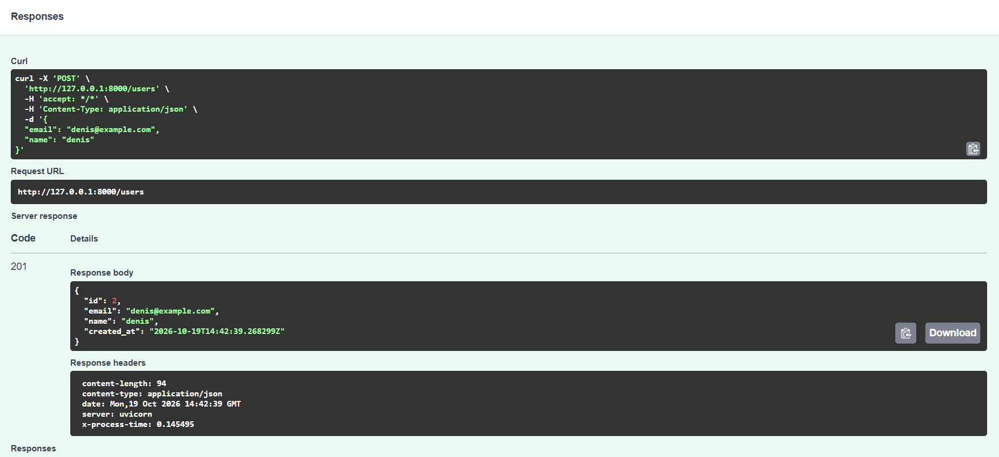
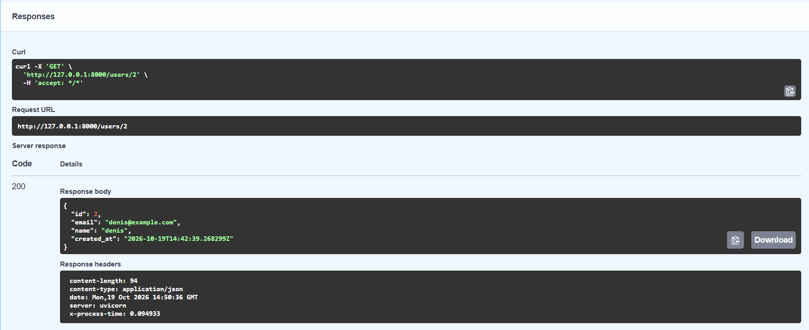
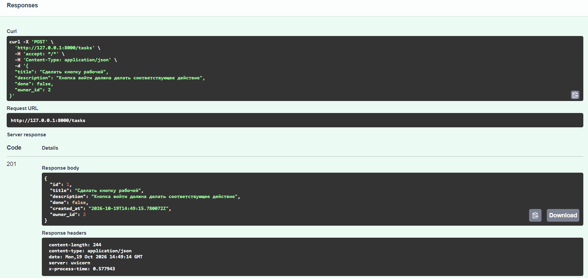
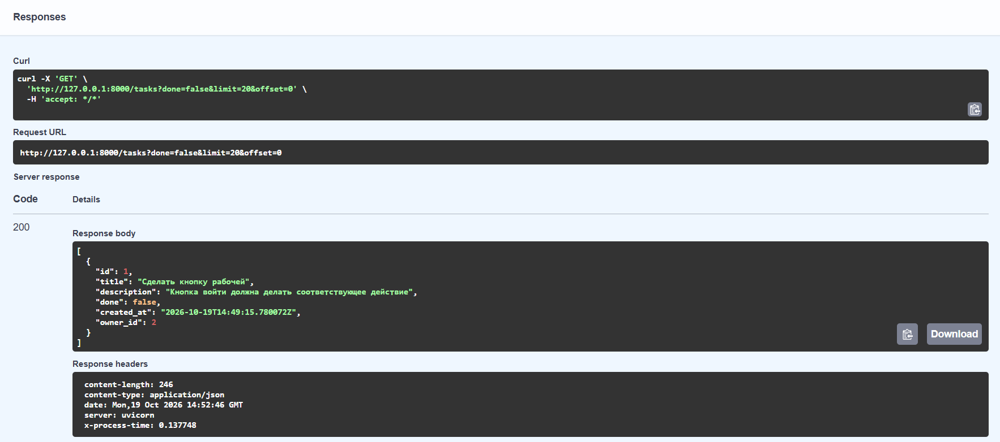
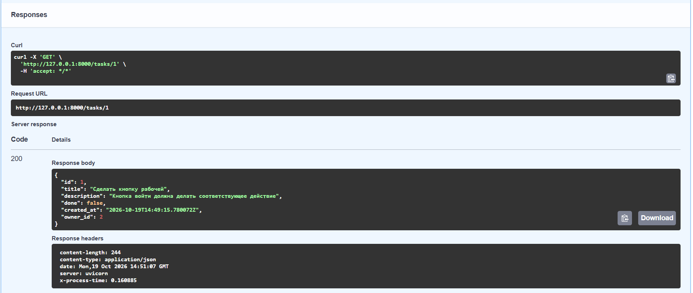
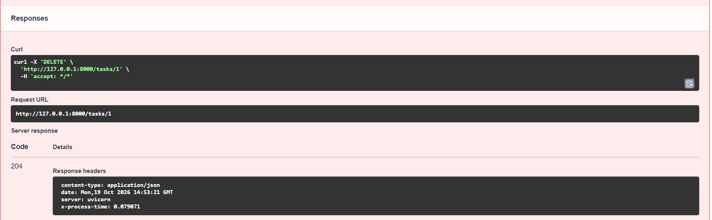
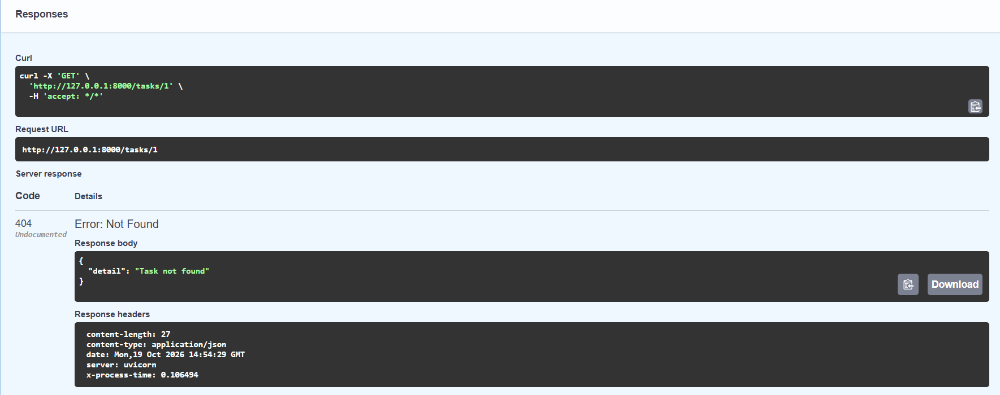
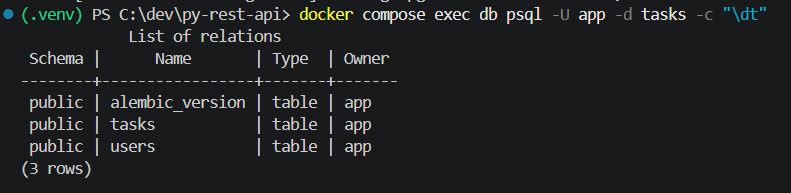
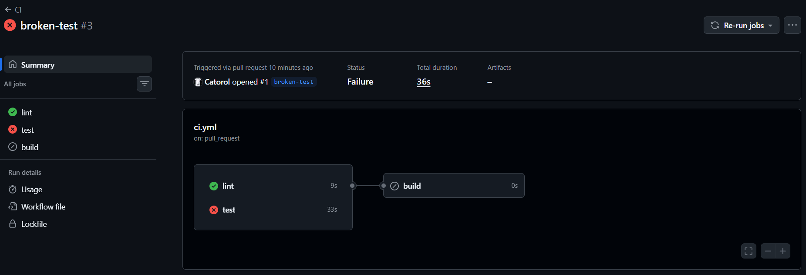
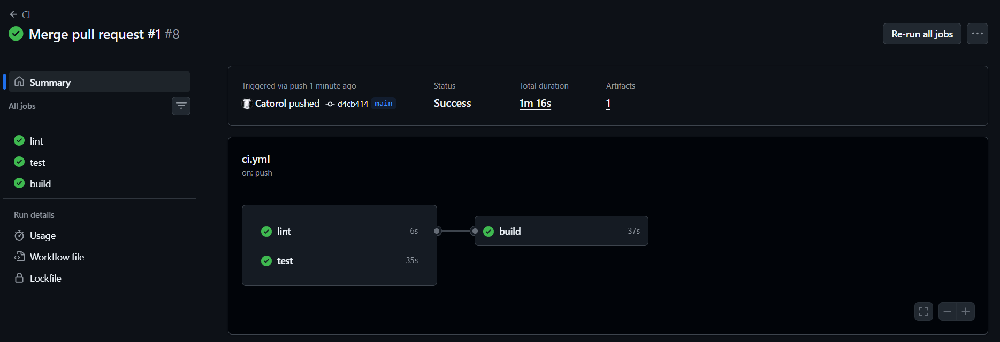

# Практическая работа №2

## Инструкция по запуску

1. Клонировать репозиторий и перейти в папку:
   ```
   git clone https://github.com/Catorol/py-rest-api.git
   cd py-rest-api
   ```
2. Создать и активировать виртуальное окружение:
   ```
   python -m venv .venv
   # Windows: .venv\Scripts\Activate.ps1
   # Linux/macOS: source .venv/bin/activate
   ```
3. Установить зависимости:
   ```
   pip install -r requirements.txt
   ```
4. Создать файл настроек:
   ```
   cp .env.example .env
   ```
5. Запустить PostgreSQL:
   ```
   docker compose up -d db
   ```
6. Применить миграции:
   ```
   alembic upgrade head
   ```
7. Запустить сервис:
   ```
   uvicorn app.main:app --reload
   ```
8. Открыть Swagger UI: http://127.0.0.1:8000/docs

## Скриншоты Swagger UI

### Успешное создание пользователя (201)


### Получение пользователя (200)


### Успешное создание задачи (201)


### Список задач с фильтрами (200)


### Задача по id (200)


### Удаление задачи (204)


### Ответ 404 (task)


### Таблицы в БД


## Ответы на контрольные вопросы

### 1. Чем FastAPI отличается от Starlette и какие компоненты Starlette он использует?

Starlette легкий ASGI-фреймворк, который не знает о валидации данных и OpenAPI.
FastAPI надстройка над Starlette (класс `FastAPI` наследуется от `Starlette`). Он добавляет валидацию данных, систему зависимостей, автоматическую генерацию схемы OpenAPI и интерактивной документации (например, Swagger UI).
Из Starlette FastAPI использует ASGI-основу и маршрутизацию, объекты `Request` и `Response`, механизм middleware, WebSocket, исключения и обработчики ошибок.

### 2. Зачем разделять схемы Create, Read и Update?

Разделять схемы нужно, так как у каждой сущности разные наборы полей и правила. Разделение помогает тем, что не будет лишних полей, клиент не подсунет служебные поля, а в документации будут неверные поля. Этот подход позволяет сделать API понятнее и безопаснее.

### 3. Что делает `from_attributes=True`?

Позволяет Pydantic брать данные не только из словаря, но и из обычного объекта, читая его атрибуты (`obj.id`, `obj.title`). Из-за этого FastAPI может вернуть объект из базы данных и превратить его в схему `*Read`.

### 4. Почему сессия передается через `Depends`, а не создается глобально?

Потому что `Depends` создает новую сессию на каждый запрос и закрывает ее после ответа, даже если произошла ошибка. Одна глобальная сессия на всех пользователей была бы общей для одновременных запросов, а их данные и транзакции перемешались бы.

### 5. Чем `exclude_unset=True` отличается от `exclude_none=True`?

`exclude_unset=True` убирает поля, которые клиент **не присылал**. Если клиент прислал `null`, поле останется. А`exclude_none=True` убирает все поля со значением `None`, даже если клиент прислал их сам.

### 6. Почему в production таблицы не создают через `create_all`?

Так как `create_all` только создает отсутствующие таблицы, а уже существующие не меняет. То есть новый столбец или индекс не появится. Также нет истории изменений и нельзя откатить изменение, нельзя безопасно сохранить данные при изменении структуры таблиц.

Миграции Alembic хранят каждое изменение схемы в отдельных файлах, которые можно проверить, применить и откатить.

# Практическая работа №3

## Бейдж статуса CI

().

## Команды для запуска тестов локально и через Docker Compose

### Локально

```
python -m venv .venv
# Windows: .venv\Scripts\Activate.ps1
# Linux/macOS: source .venv/bin/activate
pip install -r requirements-dev.txt
docker compose up -d db
pytest -v
ruff check .
```

### Через Docker Compose

```
docker compose --profile test run --rm tests
docker compose down -v
```

### Запуск приложения целиком (приложение + БД + миграции)

```
docker compose up --build
```

http://localhost:8000/docs

## Скриншот успешного pipeline и скриншот «упавшего» pipeline

### «Упавший» pipeline


### Успешный pipeline


## Ссылки на образ в GHCR и Docker Hub

https://github.com/Catorol/py-rest-api/pkgs/container/py-rest-api

https://hub.docker.com/repository/docker/catorol/py-rest-api/general

## Ответы на контрольные вопросы

### 1. Чем CI отличается от CD (continuous delivery и continuous deployment)?

CI подразумевает частую автоматическую интеграция изменений. То есть на каждый push и pull request сервер сам собирает проект, запускает линтер и тесты. Целью является выявление ошибок или прохождение без них. Каждая успешная сборка превращается в готовый к выпуску артефакт, но решение выкатывать его в production принимает человек.
CD то же самое, но выпуск в production происходит автоматически после прохождения всех проверок, без участия человека.

### 2. Как работает dependency_overrides и зачем он нужен в тестах?

`app.dependency_overrides` - это словарь, в котором ключом является оригинальная зависимость (`get_session`), а значением функция-замена. Когда FastAPI разрешает `Depends(get_session)`, он сначала смотрит в этот словарь, если замена есть, вызывает ее. В тестах это позволяет направить приложение в тестовую БД `tasks_test`, не меняя код роутеров и не трогая рабочую базу. Так же подменяют авторизацию и внешние сервисы. После теста словарь очищают, чтобы подмена не повлияла на другие тесты.

### 3. Зачем нужна многоэтапная сборка образа?

Многоэтапная сборка нужна для того, чтобы на этапе builder установить зависимости и подготовить все необходимое, а в финальный образ runtime копировать только готовое виртуальное окружение и код приложения. Из-за этого в итоговый образ не попадают кэш pip, временные файлы и лишние пакеты, то есть он получается меньше. Отдельный этап test позволяет иметь образ с pytest для запуска тестов в Compose, не увеличивая production-образ.

### 4. Почему контейнер не следует запускать от root?

Root в контейнере использует то же ядро, что и хост. При уязвимости в приложении или ошибке конфигурации проникший получает максимальные права. Непривилегированный пользователь не может менять системные файлы и устанавливать пакеты, поэтому ущерб ограничен.

### 5. Как в GitHub Actions передаются секреты и почему их нельзя хранить в репозитории?

Секреты задаются в отдельных настройках и подставляются в workflow выражением `${{ secrets.SECRETS }}`. GitHub хранит их в зашифрованном виде и маскирует значения в логах. В запусках из форков секреты не передаются. В репозитории секрет остается в истории git навсегда, виден всем, у кого есть доступ. Хранить секреты в репозитории нельзя, потому что они навсегда останутся в истории git и будут доступны всем, у кого есть доступ к репозиторию. Если секрет попадёт в код, его смогут украсть и использовать во вред.

### 6. Что произойдёт с job-ом build, если упадёт test? Где это задаётся?

Job build будет пропущен, образ не опубликуется. Это задается ключом `needs: [lint, test]` в build. Job запускается, только если все перечисленные в `needs` job-ы завершились успешно.

### 7. Где лучше применять миграции: при старте контейнера или отдельным шагом в CD? Каковы плюсы и минусы каждого варианта?

При старте контейнера.
Плюсы: просто, схема всегда соответствует версии кода, не нужен отдельный шаг в pipeline.
Минусы: при нескольких репликах миграции могут выполняться одновременно; приложению нужны права на изменение схемы; упавшая или долгая миграция блокирует старт и приводит к перезапускам; откат версии образа не откатывает схему.

Отдельным шагом в CD.
Плюсы: миграция выполняется один раз, до выкладки новой версии; можно сделать бэкап и ручное подтверждение; можно использовать отдельную учетную запись БД с правами на изменение схемы, а у приложения права урезать; при ошибке миграции старая версия продолжает работать.
Минусы: сложнее pipeline, нужно координировать порядок «миграция -> деплой», а изменения схемы должны быть совместимы со старой версией кода на время выкладки.

Лучше применять отдельным шагом, так как это безопаснее.
